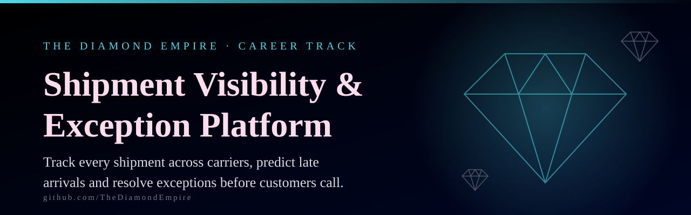
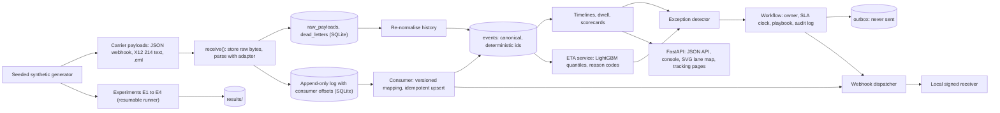

<p align="center"></p>

<p align="center">
  
  
  
</p>

# Shipment Visibility & Exception Platform

> Track every shipment across carriers, predict late arrivals and resolve exceptions before customers call.

A logistics control tower prototype: three simulated carrier feeds (JSON webhook, X12 214-style text, saved emails) are normalised into one canonical event model that keeps every raw payload, shown as shipment timelines, turned into ETA ranges with a probability of lateness, and converted into exceptions that have an owner, an SLA clock and a playbook.

**Everything runs on a seeded SYNTHETIC freight world.** There are no real carrier APIs, EDI feeds or shipment histories behind this project. The "carrier-provided ETA" used as a baseline is itself simulated by the generator under a stated optimism model, and the generator and the models were written by the same author, so good scores measure self-consistency, not performance on real freight.

**Quick links:** [Architecture](#architecture) · [Tech stack](#tech-stack) · [Engineering decisions](#engineering-decisions) · [Results](#results-at-a-glance) · [Roadmap](#roadmap) · [Getting started](#getting-started) · [Case study](docs/case-study.md) · [Research report](docs/research-report.md)

> **Public showcase.** This repository holds the documentation, client case study, research report and measured results for this product. The runnable source code is distributed separately under a license: see [SOURCE-ACCESS.md](SOURCE-ACCESS.md).

## At a glance

|  |  |
|---|---|
| **Track** | Career · Advanced |
| **Phase** | Beta: all five milestones are built and tested on synthetic data and all four experiments have recorded results. Not production software: no authentication on the console, no real carrier connections, no deployment. |
| **Primary reader** | Hiring managers and engineering leads |
| **Read next** | [README](README.md) · [Client case study](docs/case-study.md) · [Research report](docs/research-report.md) |

## Why this exists

Shippers and third-party logistics providers juggle dozens of carrier portals and EDI feeds. Status codes mean different things per carrier, ETAs are optimistic, and teams learn a shipment is late when the customer complains.

## What it does (built and tested)

- **Three carrier adapters, each with its own vocabulary.** A REST/webhook-style JSON carrier; an X12 214-style EDI text carrier with a real segment parser (ISA, GS, ST, B10, L11, LX, AT7, MS1, N1, DTM, SE, GE, IEA; control-number and segment-count validation; other segments skipped); an email carrier that parses saved `.eml` files.
- **Canonical event model with lossless raw storage.** Every payload is stored byte for byte before parsing; unparseable payloads are dead-lettered, not lost. Normalisation uses versioned, data-driven mapping files with context rules (for example the same EDI code means "departed origin" or "departed hub" depending on the N1 facility qualifier).
- **Idempotent ingestion.** A SQLite-backed append-only log with consumer-group offsets stands in for a Kafka-style stream. Event ids are deterministic, so duplicates, redelivery and consumer restarts converge to the same state (tested by fault injection and by a property test over arrival order, duplication and crash schedules).
- **Shipment timelines** ordered by when things happened, with late-arriving scans flagged and never regressing the current status.
- **Dwell-time analysis and carrier scorecards** (on-time rate, dwell, claim rate, tender acceptance, unmapped-event share) and an **offline SVG lane view** (no map tiles).
- **ETA as a distribution.** Seven LightGBM quantile models, reason codes from per-feature contributions, an estimated probability of being late, and a time-based backtest harness with explicit leakage controls.
- **Exception detection and workflow.** Late-risk, hub-dwell, stale-tracking, customs-hold, damage and failed-delivery exceptions; deterministic owner assignment; SLA clock; status machine with audit log; playbooks; customer and internal notification templates rendered into an **outbox** that is never sent.
- **Customer tracking pages** with per-customer branding and signed links, and **signed webhooks** to a local receiver (loopback only unless explicitly enabled).
- **Re-normalisation of history from raw payloads** when a mapping changes, with dry-run, idempotency and rollback.
- **A seeded synthetic generator** (lanes, carriers, delay processes, weather and congestion shocks, carrier-specific vocabularies, an explicit carrier-ETA optimism model, duplicates, stuck messages, vocabulary drift) and a **resumable experiment runner** for E1 to E4.

## Not built yet / out of scope

| Item | Why |
|---|---|
| Real carrier connections, real EDI transport (AS2/SFTP), live IMAP mailbox polling | No access to real carriers or feeds; adapters parse payloads you hand them |
| Kafka, PostgreSQL/PostGIS, ClickHouse, Docker, Terraform, OpenTelemetry, MLflow | The blueprint stack was only a proposal; one Python runtime with SQLite was enough to prove the logic, and the machine had no container daemon |
| Next.js console and MapLibre map | Replaced by a server-rendered console and an offline SVG lane view (no tile service) |
| Authentication and multi-tenant access control on the console and API | Out of scope for a local prototype; only tracking links are signed |
| Real notification delivery (email/SMS) | By design the outbox only records what would be sent |
| Business calendars, holidays and daylight-saving in SLA and time zones | Fixed UTC offsets and calendar hours are used and documented |
| Continuous production calibration monitoring and model retraining schedules | Calibration is measured in the backtest (E2); there is no production loop |
| Any result on real freight | No real data exists in this repository |

## Architecture



## Tech stack

| Layer | Technology (as built) |
|---|---|
| Runtime | Python 3.12 managed with `uv` (lockfile `uv.lock`); one runtime end to end |
| API and console | FastAPI, uvicorn; server-rendered HTML and inline SVG, no JavaScript framework |
| Storage and queue | SQLite through the standard library (`sqlite3`, WAL); the queue is a table with consumer offsets |
| Parsing | Standard library only: `json`, `email`, and a hand-written X12 214 segment parser |
| Prediction | LightGBM quantile regression; scikit-learn linear quantile regression baseline; NumPy, SciPy |
| Experiments | Own resumable runner (subprocess per unit, atomic result files), psutil for load records |
| Quality | pytest, Hypothesis (property tests), httpx test client, ruff (format and lint), mypy `--strict` |
| CI | GitHub Actions workflow in `.github/workflows/ci.yml`, written but **never run** (nothing was published) |

## Engineering decisions

### Canonical events, lossless raw data

Every carrier payload is stored untouched and also normalised into one event model. When a mapping turns out to be wrong or a carrier's wording drifts, history is re-normalised from the raw bytes instead of being lost; event ids are stable so timelines and webhook keys survive.

### An ETA is a distribution, not a number

The model outputs quantiles; the console shows a range, a probability of lateness and the main drivers. Exceptions trigger on the probability of lateness. Predictive intervals are checked for calibration per lane and carrier (experiment E2), and a split-conformal variant is evaluated.

### Exceptions are workflow objects

Each exception has an owner, a clock, a playbook and an audit log, and is opened at most once per (shipment, type, trigger). The platform reports time to acknowledge and resolve and SLA breaches, not just how many problems were detected.

### Idempotent by construction

At-least-once delivery plus deterministic event ids plus a unique key means redelivery is harmless; the consumer commits offsets in a separate transaction after the write, and tests crash it between the two on purpose.

## Quality bar

- Replay tests built from recorded payloads (committed under `tests/fixtures/replay`), including out-of-order arrival and byte-identical duplicates.
- Idempotent ingestion verified by fault injection (consumer crashes before and after processing, repeated crashes, full redelivery, offset loss) and by a Hypothesis property test.
- Time-based backtesting with leakage controls: no random split across time; features at time T are tested by truncation and by "poisoning the future".
- Strict typing (`mypy --strict` over `src` and `tests`), formatter and linter, and a CI workflow that runs the same commands as local (unrun).

## Results at a glance

All numbers come from `uv run svp-experiments run` (10 seeded synthetic worlds, about 18,800 backtested shipments, one uninterrupted invocation; raw per-seed results in `results/raw`, tables in `results/tables`). **Synthetic data only; the carrier-ETA baseline is simulated under an explicit optimism model; generator and models share an author, so these are self-consistency results, not evidence about real freight.** Intervals are 95% bootstrap CIs over the 10 seeds.

| Experiment | Hypothesis | Measured result | Verdict |
|---|---|---|---|
| E1 ETA accuracy | H1: at least 20% lower MAE than carrier ETA and lane average | MAE 9.60 h vs 22.99 h (carrier ETA, simulated) and 12.33 h (lane average): 58.2% [57.6, 58.8] and 22.1% [21.0, 23.0] lower | Supported (second margin is narrow; a simpler static-feature model was slightly better than the full one) |
| E2 Calibration | H2: 80% intervals cover 75-85% across lanes and carriers | LightGBM 75.5% [74.9, 76.1]; only 50% of lane and carrier groups inside the band; split-conformal version 79.9% [79.4, 80.5] | Not supported (intervals too narrow; repairable) |
| E3 Early warning | H3: at least 70% of late shipments flagged 12 h ahead at 80% precision | precision 0.802 [0.785, 0.819], recall 0.698 [0.674, 0.723], median lead 57.5 h | Not supported (recall just under the bar) |
| E4 Normalisation | H4: at least 50% fewer mapping errors than pass-through | 2.4% error vs 44.3% pass-through (94.7% lower) and 10.7% per-carrier table without context rules (77.6% lower) | Supported (naive baseline; vocabularies are self-authored; all remaining errors are injected email drift) |

Full tables, discussion and threats to validity: [research report](docs/research-report.md).

## Roadmap

- [x] M1: two carrier adapters (REST-style JSON and EDI 214-style text), canonical events with lossless raw storage, shipment timelines
- [x] M2: offline SVG lane view, dwell-time analysis and carrier scorecards
- [x] M3: baseline ETA and quantile models with a time-based backtest harness (leakage-controlled)
- [x] M4: exception detection and workflow (owner, SLA clock, playbook, outbox)
- [x] M5: branded tracking pages, signed webhooks to a local receiver, the email-parsing carrier, re-normalisation from raw payloads
- [ ] Not started: real carrier connectivity, authentication, production monitoring (see "Not built yet")

## Getting started

> _These instructions refer to the source package, which is distributed separately and is not part of this showcase repository._

Requirements: [uv](https://docs.astral.sh/uv/) and Python 3.12 (uv installs it). No network access is needed at runtime. Run these from the repository root.

```bash
uv sync                      # create the virtual environment from uv.lock
uv run svp demo              # generate a synthetic world, ingest it, train the ETA model, detect exceptions
uv run svp serve             # console and API on http://127.0.0.1:8000/
```

`svp demo` writes everything under the gitignored `data/` directory (feeds, SQLite database, model) and takes a few minutes on a busy machine. It walks through ingest in three phases, trains the model, runs detection, applies a scripted operator, and finally re-normalises the email carrier's drifted vocabulary from the raw payloads.

Useful commands:

```bash
uv run svp --help                                  # all commands
uv run svp scorecards                              # carrier scorecards
uv run svp renormalize MERIDIAN v2 --dry-run       # what a mapping change would do (reports 0 after `svp demo`, which already applied v2; run `svp ingest --reset` first to see the 216 repairs)
uv run svp webhook-receiver --port 8765            # local signed-webhook receiver (separate terminal)
uv run svp webhook-subscribe http://127.0.0.1:8765/hook
uv run svp webhook-dispatch
```

Open `/` (overview with the lane map), `/shipments`, `/exceptions`, `/scorecards`, `/dwell` and `/outbox`. Each shipment page links to its customer tracking page (`/t/<signed token>`). The data are synthetic and the "now" of the console is the latest event in the database, not the wall clock.

Run the experiments (resumable; writes to `results/`):

```bash
uv run svp-experiments run          # all of E1-E4 for 10 seeds, at most 2 worker processes
uv run svp-experiments status       # which units are done
uv run svp-experiments aggregate    # rebuild results/summary.json and results/tables from raw results
```

If a run is interrupted or a worker crashes, run the same command again: finished units are skipped. A single experiment unit can be run directly, for example `uv run python -m svp.experiments.e1_eta_accuracy --seed 0 --out .tmp/e1`. On machines where Python crashes because `SSLKEYLOGFILE` points at a device path, clear that variable first; nothing here needs the network.

## Verification

> _These instructions refer to the source package, which is distributed separately and is not part of this showcase repository._

```bash
uv run ruff format --check src tests scripts
uv run ruff check src tests scripts
uv run mypy
uv run pytest
```

These are the same commands as `.github/workflows/ci.yml`. The fast way to exercise the experiment runner end to end is a tiny configuration (never used for reported results): `SVP_EXP_QUICK=1 uv run svp-experiments run` writes under `.tmp/quick/`.

## Repository layout

> _These instructions refer to the source package, which is distributed separately and is not part of this showcase repository._

```
src/svp/
  canonical.py, db.py, queue.py, ingest.py     canonical model, schema, log, idempotent pipeline
  adapters/                                    rest_json.py, edi214.py, email_eml.py
  mapping.py, mappings/*.json                  versioned normaliser rules
  renormalize.py                               rebuild canonical statuses from raw payloads
  timeline.py, analytics.py, svgmap.py, netmap.py
  eta/                                         view, features (leakage-controlled), models, backtest, service
  exceptions/                                  detect.py (P(late)), workflow.py (owner, SLA, playbook, outbox)
  webhooks.py, tracking.py, web/               signed webhooks, tracking pages, FastAPI app and console
  synth/                                       generator: params, world, simulate, vocab, render
  experiments/                                 e1..e4, runner, aggregate, stats
  templates/                                   notification templates
tests/                                         unit, property, fault-injection, replay and API tests
tests/fixtures/replay/                         recorded payloads used by the replay tests
scripts/make_replay_fixtures.py                regenerates the recorded fixtures
results/                                       raw per-seed results, summary.json, tables, run metadata
docs/                                          case study and research report
```

## Skills demonstrated

`Event-driven data platforms` · `Data normalization and integration` · `Forecasting with uncertainty` · `Workflow design` · `Operational analytics` · `Reproducible experiments`

## One project, three lenses

The same project is documented for three audiences, so one body of work serves every goal.

| If you are… | Read | You will find |
|---|---|---|
| Hiring or reviewing engineers | [This README](README.md) | Architecture, trade-offs, quality bar and what I would defend in a design review |
| A client or founder | [Client case study](docs/case-study.md) | The business problem, the value levers, how it is measured and how an engagement runs |
| A researcher or technical reviewer | [Research report](docs/research-report.md) | Hypotheses, methods, statistical plan, results with intervals, threats to validity and the reproducibility checklist |

## Author

Built by **[The Diamond Empire](https://thedempire.shop/)**.
