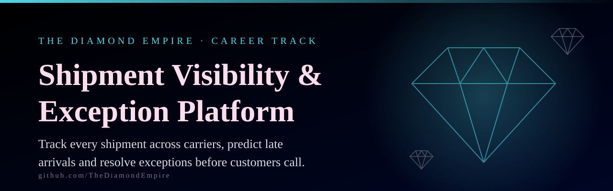

# Shipment Visibility & Exception Platform: Client Case Study

> Find problems earlier, fix them faster and negotiate with carriers using evidence.

> **Status of this document.** This is a reference case study: it sets out the business problem, the solution and the value model. The results table is intentionally blank and is filled in only from measured data (a pilot or a real engagement). No outcome figures are claimed here. The working prototype behind it runs only on a seeded synthetic freight world with simulated carrier adapters; nothing in this repository was measured on a client's freight, and the engineering results are in the [research report](research-report.md).

## Snapshot

|  |  |
|---|---|
| **Who it is for** | Shippers, freight forwarders and third-party logistics providers moving a thousand or more shipments a month across several carriers. |
| **Solution** | Track every shipment across carriers, predict late arrivals and resolve exceptions before customers call. |
| **Track** | Career · Advanced |
| **Delivered by** | The Diamond Empire |

## The challenge

Customer-service teams spend their day answering “where is my order”. Delays are discovered late, expediting is expensive, and carrier performance conversations rely on anecdotes instead of data.

## The solution

A logistics control tower that unifies carrier tracking feeds into one normalized timeline per shipment, predicts arrival times with honest uncertainty, and turns delays, damage and customs holds into prioritized exceptions with owners and playbooks.

What the client gets in practice:

- Carrier integrations through APIs, webhooks, EDI 214 and email parsing, one adapter per carrier (the prototype ships three simulated adapters: a JSON webhook carrier, an X12 214-style text carrier and a saved-email carrier; each real carrier would need its own mapping agreed with operations)
- Canonical event model that normalizes status codes while keeping every raw payload, with re-normalization of history from the raw payloads when a mapping changes
- Shipment timeline and an offline lane map (no map tiles) with milestone history and dwell-time breakdown
- ETA prediction as a range (quantiles) with an estimated probability of lateness and reason codes
- Exception workflow: detection, owner, SLA clock, playbook and customer-notification templates (the prototype writes notifications to an outbox and never sends them)
- Carrier scorecards, branded customer tracking pages and signed webhooks to downstream systems

## How it creates value

| Value lever | How the solution delivers it | How we measure it |
|---|---|---|
| Customer contacts | Proactive notifications and self-serve tracking reduce status inquiries | Status-inquiry contacts per 1,000 shipments |
| Late-delivery impact | Calibrated ETAs and early exception alerts leave time to react | On-time-in-full rate; hours between delay onset and detection |
| Expediting cost | Earlier action replaces emergency freight | Expedite spend as a share of freight spend |
| Carrier performance | Scorecards give objective data for reviews and awards | Carrier on-time and claim rates |
| Planner productivity | One view replaces dozens of portals | Hours per week spent checking tracking |

## How an engagement runs

| Phase | What happens |
|---|---|
| Map | Carriers, status codes and exception types |
| Integrate | Priority carriers and historical backfill |
| Predict | ETA model backtest and calibration |
| Operate | Exceptions workflow and monthly carrier reviews |

## What the client receives

- A platform instance with the client’s carriers integrated (hosting is not part of this repository)
- Status mapping agreed with operations
- ETA model backtested on the client’s history (the prototype's backtest harness is the starting point)
- Exception playbooks and notification templates
- Carrier scorecard pack

## Results

Baseline measurements are taken **before** the solution goes live, and the same measures are taken after, so every change in the table is attributable and honest.

| Measure | How measured | Baseline | After | Change |
|---|---|---|---|---|
| Customer contacts | Status-inquiry contacts per 1,000 shipments | — | — | — |
| Late-delivery impact | On-time-in-full rate; hours between delay onset and detection | — | — | — |
| Expediting cost | Expedite spend as a share of freight spend | — | — | — |
| Carrier performance | Carrier on-time and claim rates | — | — | — |
| Planner productivity | Hours per week spent checking tracking | — | — | — |

> **To fill in:** replace each — with measured values and add the measurement window and sample size beneath the table.

## How quality and risk are managed

- Replay tests built from recorded carrier payloads, including out-of-order and duplicate events
- Time-based backtesting for ETA models with leakage controls; no random splits across time
- Calibration checks: interval coverage measured per lane and carrier in the backtest (continuous production monitoring is not built)
- Idempotent ingestion verified by fault injection (consumer restarts, redelivery)

## Is this a fit?

Best suited to: shippers, freight forwarders and third-party logistics providers moving a thousand or more shipments a month across several carriers.

## Talk to me

Want this adapted to your business? Get in touch via **[thedempire.shop](https://thedempire.shop/)**.

---

[README](../README.md) · [Client case study](case-study.md) · [Research report](research-report.md)
